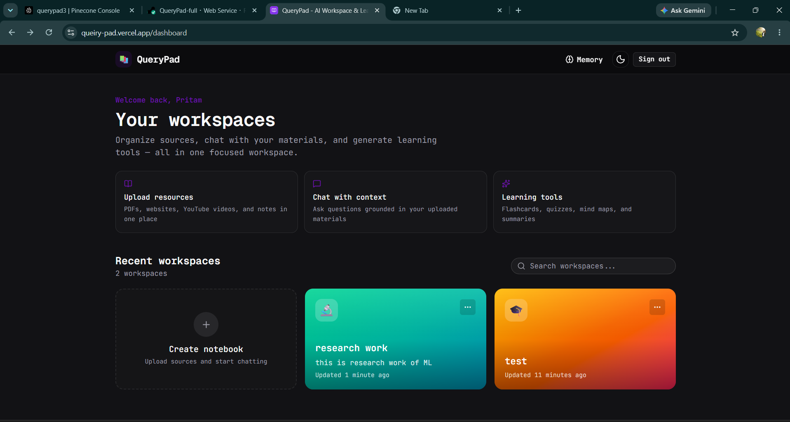
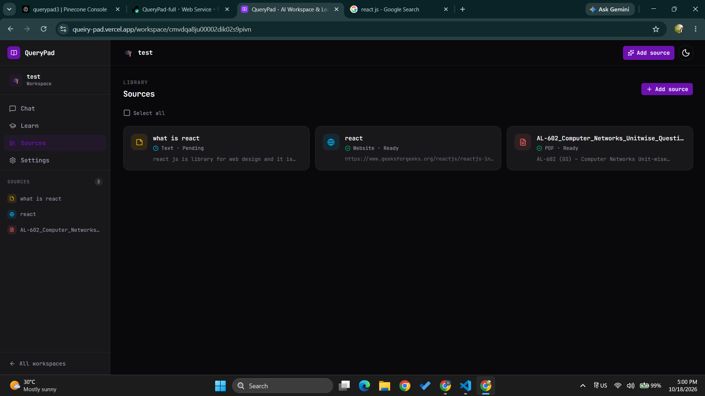
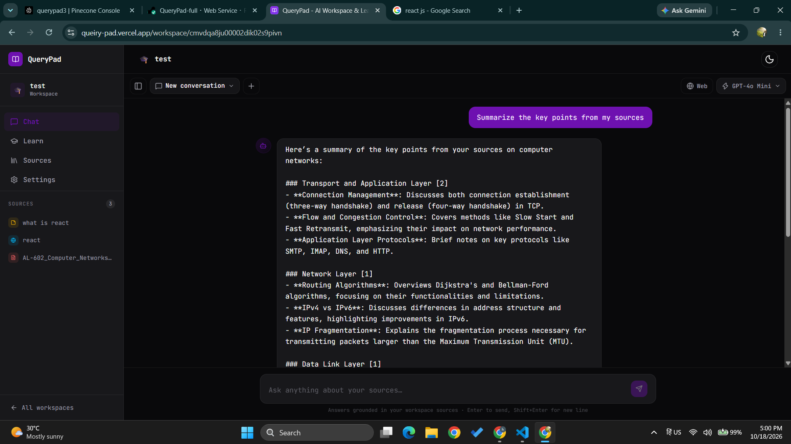
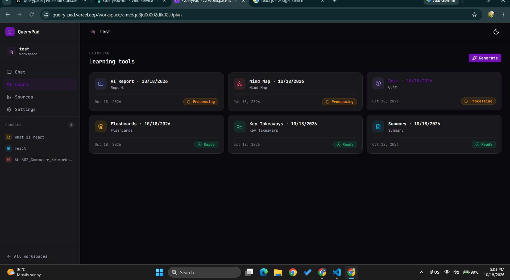

# QueryPad

QueryPad is an AI workspace for studying and researching your own materials. Keep sources organized in workspaces, ask questions about them, and turn them into useful learning tools.

**Live app:** [queiry-pad.vercel.app](https://queiry-pad.vercel.app)

## What you can do

- Add PDFs, websites, YouTube videos, and text as sources.
- Chat with your sources and get answers grounded in your materials.
- Generate summaries, key takeaways, flashcards, quizzes, mind maps, and reports.

## Screenshots

| Workspaces | Sources |
| --- | --- |
|  |  |
| **Chat** | **Learning tools** |
|  |  |

## Built with

Next.js, React, Tailwind CSS, Express, PostgreSQL, Prisma, Pinecone, and OpenAI.

The app is split into `client/` for the web interface and `server/` for the API.
